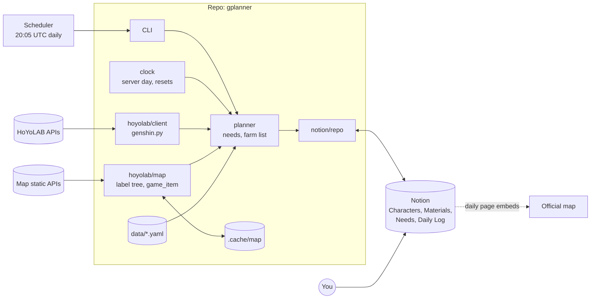

# Genshin Notion Planner: Design

**Version:** 2 (November 2026)
**Owner:** Sujay
**Status:** Draft, ready to start building

## 1. What this is

A Python tool that keeps a Notion planner in sync with a Genshin Impact account (AR 59, Asia server). It pulls the character roster from HoYoLAB, works out which materials each character still needs, and writes a daily page that says what to farm today, for whom, and where. The official Teyvat Interactive Map is embedded in the daily page, so "where" is one tap away.

Notion is the interface. The script does the bookkeeping. You set targets and priorities, and the script handles everything else.

## 2. Requirements

### What it does

1. **Roster sync.** Every owned character in Notion, with level, ascension, constellation, talents and weapon.
2. **Needs.** For each character you mark as building, the materials needed to go from current levels to your targets.
3. **Daily page.** Created after each server reset: live resin and when it fills, commissions, expeditions, and a farm list of what's farmable today on the server, sorted by priority, with a link to the right map route.
4. **Weekly section.** On the server's Monday: weekly boss discounts left and other weekly resets.
5. **Map.** The official interactive map embedded in the daily page, plus per-material links that open the right harvest route.

### What it must get right

- **Idempotent runs.** Running anything twice changes nothing the second time.
- **Never overwrite your edits.** Every Notion property is owned by either the script or you (section 6.2).
- **Server time is the truth for game logic.** Display times are converted to Boston time (section 7).
- **Secrets stay out of git.** Cookies, tokens and raw captures never get committed.
- **Breakage stays small.** HoYoLAB APIs are unofficial. When one changes, the run degrades and says so instead of failing outright (section 11).

### Scale and constraints

One user, one account, a few runs a day, a roster under about 150 characters. Load doesn't matter. The real constraint is Notion's API limit of about three requests per second on average, which a run of this size stays well under. The stack is Python 3.11+, since genshin.py is Python and async.

## 3. Architecture



Five pieces, each with one job:

| Component | Job | Talks to |
|---|---|---|
| `hoyolab/client.py` | Roster, talents, Real-Time Notes, calculator, all through genshin.py | HoYoLAB |
| `hoyolab/map.py` | Map categories, character-to-map links, harvest routes, map version | Map static APIs |
| `clock.py` | Server day, next reset, local display times | Nothing |
| `planner/` | Pure logic: needs, material classification, farm list, page content | Nothing |
| `notion/` | Schema setup, upserts, page creation | Notion |

Only `hoyolab/` imports genshin.py or calls HoYoLAB. Only `notion/` calls Notion. `planner/` and `clock.py` work on the project's own models in `models.py` and make no network calls, which keeps them easy to test. If genshin.py breaks, or we add Enka for builds later, the change stays inside one folder.

## 4. Data sources

### 4.1 HoYoLAB through genshin.py

| Data | Used for | Auth |
|---|---|---|
| Character list and details | Characters database | Cookies |
| Real-Time Notes | Resin, commissions, expeditions, weekly boss discounts | Cookies, Real-Time Notes enabled on HoYoLAB |
| Enhancement Progression Calculator | Material costs from current to target levels | Cookies |

genshin.py works out the Asia server from the UID. Exact method names get confirmed against the current genshin.py docs when we write the client, since the library releases monthly.

### 4.2 Interactive map APIs

Found by capturing the map's network traffic. The full shapes are in `docs/endpoints.md`. We use only the small static calls. The embedded map handles everything visual, so there's no pin scraping.

| Endpoint (`sg-public-api-static.hoyolab.com/common/map_user/ys_obc/...`) | Used for |
|---|---|
| `v3/map/info` | `map_version` hash, used as the cache key |
| `v2/map/label/tree` | 821 map categories: names, spawn counts, harvest route share links |
| `v1/map/game_item` | Each character and weapon's linked map categories (specialty, enemies, boss) |
| `v1/map/get_area_pageLabel` | Nation names for area IDs |

These need no login and change about once per patch. The daily run makes one call to `map/info`. If `map_version` hasn't changed, it uses the cache in `.cache/map/<map_version>/`.

**Optional, only if the embed can't show you logged in:** `sg-public-api.hoyolab.com/.../v1/map/get_game_exploration_rate` returns exploration by nation and area. It needs cookies, the UID and `region=os_asia`.

**Deliberately not used:** `point/list`, `point_group`, and the other pin and UI endpoints. The embed already shows them.

### 4.3 Static data in the repo

| File | Contents | Updated |
|---|---|---|
| `data/domain_schedule.yaml` | Talent book and weapon material families mapped to their domain days | By hand, when a region adds new books |
| `data/material_overrides.yaml` | Type or source for any material the script can't classify | By hand, rarely |

The calculator says which materials a character needs but not which days they can be farmed. That's the gap these files fill.

## 5. How materials get classified

Each material the calculator returns gets a type, a source, farm days and a resin cost, worked out in this order:

1. **In `domain_schedule.yaml`:** talent book or weapon material. Farm days come from the schedule. The resin cost is 20.
2. **In the map data for that character** (through `game_item` labels and the label tree): local specialty, common enemy drop, or boss drop. The source and route link come from the label.
3. **In `material_overrides.yaml`:** whatever the override says.
4. **Anything else:** marked `Unclassified` and flagged on the daily page, so you know to add an override.

## 6. Notion workspace

### 6.1 Databases

`init-notion` creates all four databases once and writes their IDs to `.env`. `init-notion --check` later confirms nothing has been renamed or deleted.

**Characters:** one row per owned character.

| Property | Type | Owner |
|---|---|---|
| Name | title | script |
| HoYo ID | number | script (upsert key) |
| Element, Weapon type, Rarity | select | script |
| Level, Ascension, Constellation | number | script |
| Normal / Skill / Burst | number | script |
| Weapon | text | script |
| Last synced | date | script |
| Building | checkbox | you |
| Priority | number (1 = first) | you |
| Target level, Target Normal / Skill / Burst | number | you |

**Materials:** one row per material used by any character you're building.

| Property | Type | Owner |
|---|---|---|
| Name | title | script |
| HoYo item ID | number | script (upsert key) |
| Type | select | script |
| Source | text (domain, boss or map category) | script |
| Region | select | script |
| Farm days | multi-select | script |
| Resin cost | number | script |
| Spawn points | number | script |
| Map link | URL (harvest route if one exists) | script |
| Needed | rollup, sum of Needs quantity | formula |
| Owned | number | you |
| Short by | formula, max(Needed minus Owned, 0) | formula |
| Last collected | date | you |
| Back at | formula, Last collected plus respawn hours | formula |

**Needs:** the join table. One row per character and material pair.

| Property | Type | Owner |
|---|---|---|
| Key | title, e.g. "Zibai: Glaze Lily" | script |
| Character | relation | script |
| Material | relation | script |
| Quantity | number | script |

A Notion relation can't carry a quantity on its own, and that's why this table exists. A needs sync replaces a character's rows only when their levels or targets have changed.

**Daily Log:** one page per server day.

| Property | Type | Owner |
|---|---|---|
| Title | title, e.g. "Thu 26 Nov" | script |
| Server day | date | script (upsert key, with Kind) |
| Kind | select: Daily, Weekly | script |
| Resin at sync | number | script |
| Resin full at | date and time, shown in Boston time | script |
| Commissions | text, e.g. "2/4" | script |
| Weekly boss discounts left | number | script |
| Synced at | date and time | script |
| Notes | text | you |

### 6.2 The ownership rule

Each property belongs to the script or to you, never both. The script reads your properties and writes only its own. Change a target, and the next sync recalculates. Type a note, and nothing overwrites it. Formulas and rollups belong to Notion. `init-notion` writes them, and nothing touches them after that.

### 6.3 Daily page layout

Top to bottom:

1. **Header:** "Server: Thursday. Next reset 3:00 PM." Resin now, when it fills, and commissions.
2. **Warnings, if any:** expired cookies, unclassified materials, map data served from an old cache.
3. **Checklist:** commissions, spend resin, expeditions, teapot. To-do blocks.
4. **Farm list:** one to-do per material, like "Glaze Lily: 18 short, for Zibai. Inazuma. [route]". Built from today's server day, filtered to materials you're still short on, and ordered by character priority. Talent books and weapon materials come first, since they're tied to the day.
5. **Weekly block (server Mondays only):** weekly bosses with discounts left, plus reputation bounties and the Parametric Transformer.
6. **Map embed:** the official map at `https://act.hoyolab.com/ys/app/interactive-map/index.html?bbs_presentation_style=no_header&lang=en-us#/map/2`.

The farm list is written by the script, not built as a Notion filtered view. A Notion formula would have to compute the server day in your time zone, and that breaks twice a year with daylight saving time. The script already knows the server day (section 7).

## 7. Time model

The Asia server is on UTC+8, with no daylight saving time. It resets daily at 04:00 server time, and the weekly reset is Monday at 04:00 server time. Boston switches between EST and EDT, so on your clock the reset moves:

| | Nov to mid-March (EST) | Mid-March to Nov (EDT) |
|---|---|---|
| Daily reset | 3:00 PM | 4:00 PM |
| Weekly reset | Sunday 3:00 PM | Sunday 4:00 PM |
| Scheduled run (20:05 UTC) | 3:05 PM | 4:05 PM |

Rules:

1. Store and compare everything in UTC or server time. Convert to local time only for display.
2. The server day is the date of (now in UTC+8, minus 4 hours). Domain availability comes from that day's weekday, and Sunday means everything is open.
3. All time logic lives in `clock.py`. Nothing else does date math.
4. Offsets and zones come from config, never from code.

Two consequences to keep in mind. After 3 PM Boston time, the server is already on tomorrow, so at 5 PM on a Wednesday the Monday/Thursday books are the ones up. And Sunday's open-everything day runs from Saturday 3 PM to Sunday 3 PM on your clock.

`clock.py` exposes `server_day()`, `next_reset_local()`, `is_server_monday()` and `to_local(dt)`.

## 8. Flows

All commands share one rule: read first, compute in `planner/`, then write. A crash partway through leaves Notion the way it was or fully updated, never half-written.

**`refresh-map`** (inside every `run`): fetch `map/info`. If `map_version` changed, fetch the label tree, `game_item` and area labels into a new cache folder. Otherwise keep the existing cache.

**`sync-roster`:** fetch characters, normalize them into models, and upsert into Characters by HoYo ID. Only script-owned properties are written.

**`sync-needs`:** read Characters where Building is checked, along with your targets. For each character whose levels or targets changed, ask the calculator for the cost. Classify each material (section 5), upsert it into Materials, and replace that character's Needs rows.

**`daily`:** fetch Real-Time Notes, compute the server day, and build the farm list from Materials that are short and farmable today. Then create or update the Daily Log page for that server day. On a server Monday, it also writes the weekly block.

**`run`:** refresh-map, sync-roster, sync-needs, then daily. This is what the scheduler calls.

Every command takes `--dry-run`, which prints what would change and writes nothing.

## 9. Repo layout

```
genshin-notion-planner/
├── src/gplanner/
│   ├── cli.py
│   ├── config.py
│   ├── models.py
│   ├── clock.py
│   ├── hoyolab/
│   │   ├── client.py
│   │   └── map.py
│   ├── notion/
│   │   ├── schema.py
│   │   └── repo.py
│   └── planner/
│       ├── needs.py
│       ├── classify.py
│       └── daily.py
├── data/
│   ├── domain_schedule.yaml
│   └── material_overrides.yaml
├── tools/
│   └── har_summary.py
├── docs/
│   ├── DESIGN.md
│   └── endpoints.md
├── tests/
│   ├── fixtures/
│   ├── test_clock.py
│   ├── test_classify.py
│   ├── test_needs.py
│   └── test_daily.py
├── .github/workflows/
│   ├── ci.yml
│   └── daily.yml
├── .env.example
├── .gitignore
├── pyproject.toml
└── README.md
```

## 10. Config and secrets

`.env`, never committed. `.env.example` is committed with every key blank:

```
HOYOLAB_LTUID_V2=
HOYOLAB_LTOKEN_V2=
HOYOLAB_LTMID_V2=
GENSHIN_UID=
NOTION_TOKEN=
NOTION_DB_CHARACTERS=
NOTION_DB_MATERIALS=
NOTION_DB_NEEDS=
NOTION_DB_DAILY=
LOCAL_TZ=America/New_York
SERVER_UTC_OFFSET=8
RESET_HOUR=4
SPECIALTY_RESPAWN_HOURS=48
```

`.gitignore` includes `.env`, `*.har`, `.cache/`, and any local fixture captures that haven't been scrubbed yet.

The HoYoLAB cookies work like a login. If they ever leak, logging out of HoYoLAB everywhere should invalidate them. Changing the password definitely does.

## 11. Failure handling

The daily page should get written even when parts of a run fail, with a warning saying what's missing.

| What fails | What happens |
|---|---|
| HoYoLAB cookies expired | Roster and needs skip. The daily page is still built from existing Notion data, with a "refresh your cookies" warning. Exit code is non-zero. |
| HoYoLAB transient error or rate limit | Up to 3 retries with backoff, then treated as a failure for that step. |
| HoYoLAB captcha challenge | Stop that step and say so. This most likely means the run came from a cloud IP. |
| Map static calls fail | Use the newest cached version. With no cache, farm list items have no map links. |
| Map data shape changed | Same as above, and the error is logged with the endpoint name. |
| Notion 429 | Wait for the time Notion's Retry-After header says, then retry. |
| Notion property missing or renamed | Fail fast and name the property. `init-notion --check` explains how to fix it. |

## 12. Testing

- **`clock.py`:** frozen times at 2:59 PM and 3:01 PM Boston, both DST switch dates, Saturday afternoon into Sunday, and Sunday afternoon into Monday.
- **`classify.py` and `needs.py`:** fixtures built from real responses with personal data removed. `tools/har_summary.py` helps check the structure first.
- **`daily.py`:** given Materials and a server day, the farm list and page blocks come out as expected.
- **`notion/`:** tested against a fake client that records calls, which also checks idempotency (a second run makes zero writes).
- **CI** runs tests and lint only. It never touches live APIs.

## 13. Scheduling

`run` goes daily at 20:05 UTC, five minutes after the Asia reset. That time never changes, because UTC+8 has no DST.

The run starts on a local scheduler (Windows Task Scheduler or cron). Once it's reliable, GitHub Actions is worth trying (`cron: "5 20 * * *"`, secrets stored as repo secrets). The open question is whether HoYoLAB challenges requests from GitHub's IPs. If it does, the run stays local.

Windows Task Scheduler triggers on local time, not UTC. A fixed 3:05 PM trigger would fire an hour before the reset all through daylight saving time. Set the local trigger to 4:10 PM instead, which is after the reset under both EST and EDT. Runs are idempotent, so the extra delay in winter costs nothing.

## 14. Key decisions

| Decision | Chosen | Alternative | Why |
|---|---|---|---|
| Storage | Notion only | SQLite plus Notion | Fewer moving parts. Fine at this scale. Revisit if runs get slow. |
| HoYoLAB access | genshin.py behind an adapter | Own client | Maintained and released monthly. The adapter keeps a break contained. |
| Map | Embed the official map, plus 4 small cached calls | Scrape pins, or use an unofficial map | Less code, always current, official data. The cached calls give per-character "where" and route links. |
| Farm list | Written by the script | Notion filtered view | Correct server day and DST-safe. Notion formulas can't do that cleanly. |
| Domain days | Static YAML | External data API | Tiny, changes a couple of times a year, no extra dependency. |
| Scheduler | Local first | GitHub Actions first | Unknown captcha risk from cloud IPs. |

## 15. Open questions

1. **Embed login.** Does the embedded map show you logged in, in the Notion desktop app and on mobile? If not, exploration comes from the optional API call instead.
2. **Embed size from the API.** The Notion API probably can't set an embed's height. If it can create pages from the Daily Log template, the embed gets sized once in the template. If not, the script adds the embed at the default size.
3. **Material counts.** Not found in the first map capture. Find out whether the map exposes them anywhere, and if not, whether a scanner export (GOOD format) is worth adding.
4. **Respawn hours.** The map's default timer for local specialties is 72 hours. The config default is 48. Check this in the game and pick one.
5. **Route links in English.** The route share links come with `lang=zh-cn`. Confirm that swapping in `lang=en-us` works.
6. **Cookies for map endpoints.** The capture was sanitized, so we don't yet know which cookies the personal map endpoint needs. Probably the same v2 cookies.
7. **genshin.py method names** for detailed talents and the calculator, confirmed against current docs.

## 16. Build plan

| Milestone | Delivers | Done when |
|---|---|---|
| M0 | Skeleton, config, `clock.py` with tests | Tests pass with no network |
| M1 | HoYoLAB auth, `sync-roster --dry-run` printing your roster | Your real roster prints. This is the riskiest step, so it comes first. |
| M2 | `init-notion`, roster sync writing to Notion | Characters database filled in. A second run makes zero writes. |
| M3 | Calculator, classification, map cache, Materials and Needs | Short-by numbers look right for one character you're building |
| M4 | Daily page with notes, farm list, warnings and map embed | Today's page matches what's actually open in game |
| M5 | Scheduler, weekly block, failure warnings | A week of unattended runs with no duplicate pages |

## 17. Later

- Material counts from a scanner export, so Owned fills itself in.
- Enka for artifact builds on the characters you're building.
- A ping when resin is close to full.
- An exploration-by-region view, if the embed doesn't cover it.
- Moving storage to SQLite if Notion gets slow.
